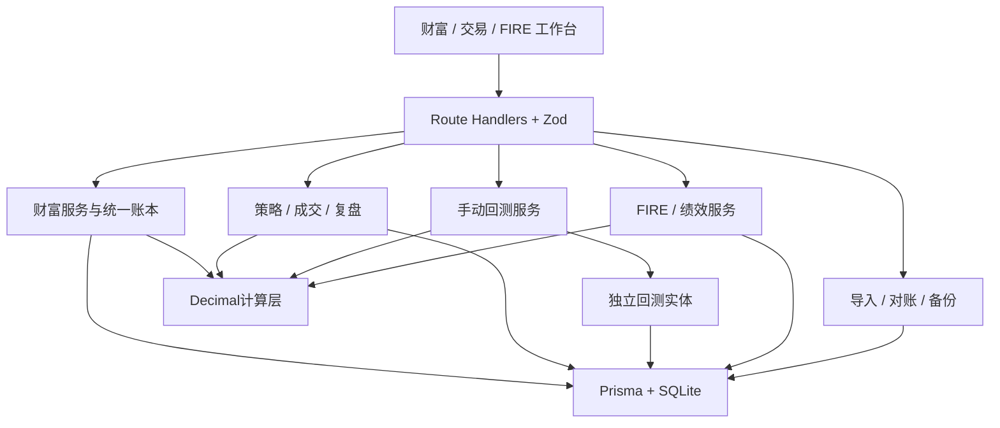

# 系统架构

TradeOS采用Next.js模块化单体，SQLite本地存储，Prisma负责持久化。页面结构与业务服务分离，多个简单路由共享工作台组件，避免为每个页面重复一套数据逻辑。

## 模块与入口

| 层     | 主要文件                                             | 职责                                     |
| ------ | ---------------------------------------------------- | ---------------------------------------- |
| 页面   | `app/wealth`、`app/[...slug]`                        | 路由、合法页面名单、明细筛选上下文       |
| 界面   | `components/*-view.tsx`、`workspace.tsx`             | 表单、分页表格、报表、共享状态刷新       |
| API    | `app/api/*/route.ts`                                 | JSON请求、业务错误、下载响应             |
| 财富   | `lib/services/wealth.ts`、`history.ts`、`summary.ts` | 账本、转账、估值、历史重建、首页指标     |
| 交易   | `trading.ts`、`analytics.ts`                         | 版本、计划、成交、复盘、筛选、绩效和归因 |
| 回测   | `backtest.ts`                                        | OHLCV校验、cursor、分支、模拟成交        |
| FIRE   | `fire.ts`                                            | 可投资净资产、目标、投入和退休模拟       |
| 数据   | `imports.ts`、`data.ts`                              | CSV幂等、对账、完整备份及恢复            |
| 持久化 | `lib/repositories/db.ts`                             | 单一Prisma实例及SQLite适配器             |
| 计算   | `lib/calculations/decimal.ts`                        | 可独立验证的金融计算                     |

## 一致性与数据流

真实成交在同一事务内写入TradeFill、AssetTransaction、余额、交易汇总及持仓事件。每个成交唯一关联一条账本记录；现货数量进入统一持仓，合约只计入现金结算与保证金占用，避免名义本金变成资产。

普通流水更新资产余额和必要的现金余额。转账先扣源账户并保存IN_TRANSIT，再到账目标账户；全局只计一次在途资产。账户内部流与外部本金分别记录，内部转账不增加全局收益。

金融字段在接口中保持字符串；数据库不使用浮点SUM。只有图表绘制、日期和整数控制使用Number。Zustand保存报告币种及界面偏好，不能作为账本来源。切换币种时隐藏旧数值并用请求顺序防止旧响应覆盖新币种。

历史计算按UTC时间重建资产、成交状态及有审计记录的负债余额，使用截至该时点有效的报价，禁止用当前余额回填过去。流水按账户sequence、成交按交易sequence保证相同时间戳的确定顺序。

回测仅写BacktestSession、Candle、BacktestTrade；服务端返回至cursor为止的K线，公共state接口不返回未来K线。完整备份包含整个回测历史，因此备份文件属于用户的数据管理渠道，不能当作受限回放的数据接口。

## 本地访问与部署

默认开发和生产进程监听127.0.0.1。生产启动脚本准备standalone静态资源并把数据库路径绝对化，避免独立服务器切换工作目录后创建另一个账本。恢复前备份和SQLite备份从数据库绝对路径确定位置，保存在数据库旁的backups目录。proxy验证loopback Host，对API检查Origin和跨站来源；写入口要求JSON。首版没有登录或多用户权限，适用本机访问。Docker内部监听容器网卡，Compose仅向宿主机loopback映射。

服务没有价格网络依赖或交易执行连接。SyncJob保留未来同步记录接口，当前没有只读同步任务。SQLite、JSON备份、附件均在本机；完整备份包含个人财务内容，Git忽略data、环境配置和生成文件。

## 性能边界

读接口使用事务一致视图，附件和未来K线不进入工作台共享state，表格在客户端筛选、排序和分页，历史报价查询有时间索引。当前验证为个人演示规模；尚未做万笔流水或多年分钟K线压力测试。未来规模增加后应依据测量增加服务端分页和查询优化，当前不增加缓存、队列或微服务。

## 安卓离线样机进展

2026-10-10：已交付第一阶段原生SQLite离线样机，计算与校验共用逻辑已提取到 `packages/core`。完整业务迁移尚未完成，第一阶段OPPO Pad Mini实机验收已由用户确认通过。详见[安卓迁移记录](android-migration.md)。

2026-10-10：离线资产版0.2.0增加现货持仓、买卖、报价与旧数据无损升级。现货输入校验及金额变更规则在 `packages/core/src/spot-ledger.ts` 共用，Web保留原来的持久化和交易预留资金检查，安卓使用本机原子批量事务。完整交易日志、回测、复盘、负债及转账迁移继续推进，详见[安卓迁移记录](android-migration.md)。

2026-10-12：离线交易版0.3.0接入现货策略版本、风险计划、分批成交与持仓事件。Web和安卓共用 `packages/core/src/trading.ts` 的输入及成交汇总计算；原生AssetLedger、现金、持仓、Trade、TradeFill及PositionEvent在同一事务内提交，普通资产流水不能动用未平仓交易占用持仓。数据库与备份版本升至3，保留旧数据。合约、回测与复盘等模块尚未迁移，见[安卓迁移记录](android-migration.md)。

2026-10-12：0.4.0补齐离线交易复盘与策略改进闭环，新增规则快照、交易绩效筛选及复盘到新草稿的事务关联。Schema和备份4保留旧版数据，可恢复v1/v2/v3。绩效范围为已平仓交易，整体账户收益率、合约和回测仍待迁移。详见[安卓迁移记录](android-migration.md)。
